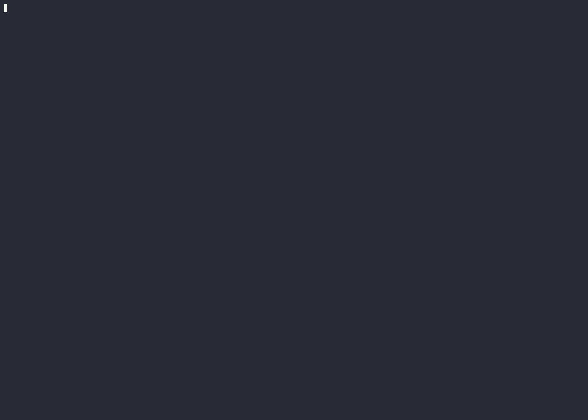

# ifabsec: zero trust inside the inference engine

Zero-trust networks verify who you are at the front door. Inside a shared
inference server, that identity is gone: every tenant's requests share one
prefix cache, one batch and one router. The prefix cache alone is enough to
leak: a cached prompt returns its first token faster, and servers often report
how many prompt tokens were cached, so a co-tenant can test whether someone
else just sent a given text.



*A real run of [`bash scripts/demo.sh`](demo/README.md) on an A100: the number was typed at a hidden prompt; Eve's
program never received it.*

ifabsec carries verified identity from the zero-trust layer into the engine and
enforces it there:

```
client or agent
  → zero-trust layer: verified identity
  → policy gateway (Go): decides scopes, mints a signed label token
  → inference engine (SGLang + ifabsec patch): verifies the token, enforces scopes
  → GPU
```

The gateway decides; the engine enforces. The engine holds only the gateway's
public keys, never trusts labels in a request body, and keys its prefix cache
by `(scope, token)` instead of `token`. Identical text under different scopes
never matches, so the probe can't form the victim's key. Content the gateway
approved for an org, such as its system prompt, is still shared across that
org.

## Why not just isolate every tenant?

Per-tenant isolation is safe, but it throws away the cache hits on prompts
that are legitimately shared: an org's system prompt, tool schemas, shared
documents. SGLang already has a per-request `cache_salt` that isolates a whole
prompt; it is set per request, so it is only as trustworthy as whoever sets it
(ifabsec has the gateway set scopes and rejects client-chosen salts). ifabsec's claim is **the same
isolation as per-tenant salting, while keeping the hits on approved shared
content**. The v0.1 benchmark exists to measure exactly that.

## What's here

| Path | What it is | Status |
|---|---|---|
| `demo/` | One-command live demo: the audience types an account number, Eve reads it from a stock server and fails with labels (`bash scripts/demo.sh`) | Run on an A100 |
| `docs/label-token.md` | The `ifab1` label-token spec and verification checklist | Draft v1 |
| `docs/threat-model.md` | Channels, attacker positions, what is in and out of scope | Draft |
| `gateway/token` | Go: Ed25519 mint and verify, scope rules, replay protection | Tested |
| `gateway/cmd/ifabsec-mint` | Go CLI: generate a gateway key, mint test tokens | Works |
| `engine/ifabsec_engine` | Python: verify tokens, check approved content, per-token scopes, page alignment, scoped cache keys | Tested |
| `engine/ifabsec_engine/refcache.py` | Reference prefix cache used as the test oracle | Tested |
| `engine/ifabsec_engine/sglang_glue.py` | Ingress labeling and scoped radix-key ids for SGLang | Tested; run on GPUs |
| `engine/sglang/` | The SGLang patch, pinned commit, run instructions and GPU checklist | Run on RTX 4090 and A100 GPUs |
| `attack/` | Guessing and digit-extraction attacks over timing and cached-token counts, a fake server, and the pod runner | Run on RTX 4090 and A100 GPUs |
| `bench/` | Latency and throughput under multi-tenant load: stock vs per-user salt vs labels | Run on RTX 4090 and A100 GPUs |
| `sim/` | Hit-rate simulation: stock vs per-org vs per-user isolation vs labels | Runs in seconds |
| `testdata/token_vector_v1.json` | A Go-minted token both test suites check, so the implementations can't drift | — |

Limits and next steps are in the [white paper](docs/whitepaper.md#threat-model-and-limits).

White paper: [`docs/whitepaper.md`](docs/whitepaper.md) (design, threat model, results, related work).
Magazine-style article: [`docs/story.md`](docs/story.md). A PDF is built on every change by the `story-pdf` workflow (Actions tab → latest run → Artifacts), or locally with `python3 scripts/story_pdf.py` (needs pandoc and Chrome).

## Results so far

Two runs on an RTX 4090 with Qwen3-8B (details in
[`docs/results/2026-11-21-rtx4090.md`](docs/results/2026-11-21-rtx4090.md)):

- On stock SGLang, a same-org co-tenant extracted a 6-digit account number
  from cached-token counts in every trial, and a right guess came back 42 ms
  faster. With labels: no digits, no timing gap.
- Under a 64-user load, labels kept stock's cache hit rate (82.1% vs 82.6%)
  with 4.4× faster first tokens and 3× the throughput of per-user isolation.
  That gap is inflated by the 4090's small KV cache (6,860 tokens).
- Labels change neither the model's input tokens nor its greedy output.

On an A100 80GB ([`docs/results/2026-11-21-a100.md`](docs/results/2026-11-21-a100.md)):

- Stock guessing reached 100% (36.6 ms timing gap) and extraction recovered
  6/6 digits; with labels, 0 digits and a 0.02 ms gap.
- At 256 users, labels matched stock's hit rate (88.6% vs 88.5%) and
  throughput (34.5 vs 34.6 req/s); per-user isolation fell to 48.3% and
  14.7 req/s. At 1,024 users, after the overhead fixes, labels cost about
  25 ms at p50 time-to-first-token (17–34 ms over three runs) and ~2% of
  throughput; p95 is within ~5% of stock.
- A second template family (Phi-4-mini) passes all checks after the
  common-prefix boundary fix.

## Run the tests

```sh
(cd gateway && go test ./...)
(cd engine && pip install -e '.[test]' && python -m pytest)
```

No GPU is needed. The engine tests include a randomized noninterference check:
one user's cache hits are identical whether or not other users (in the same org
or another org) sent private text. Removing scopes from the cache keys makes
that test fail, which is the leak.

## Ground rules

- Attacks run only against our own servers, with synthetic tenants and fake data.
- Findings in third-party systems are reported to their maintainers before
  anything is published.

## License

Apache 2.0, the same as SGLang.
