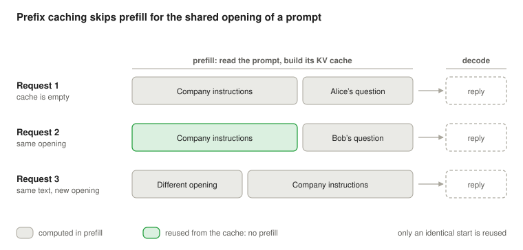
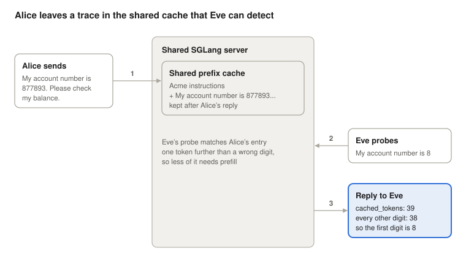

# Sharing an AI server without sharing secrets

November 21, 2026 · a companion to the [white paper](whitepaper.md)

Nearly every serious LLM deployment relies on prefix caching. When a prompt opens with text the server has already processed, it reuses that work instead of repeating it. That is a large part of why long system prompts and agent tool definitions are affordable. On a server shared by many users, it is also a side channel. On our test hardware it let one user recover a colleague's six-digit account number in 60 ordinary API calls. This article covers the mechanism, the attack, the usual fix and its cost, and an alternative from zero-trust networking that keeps both the isolation and the cache.

## Why inference servers cache prefixes

A model on its own is a file of weights. An inference server turns it into a service: it loads the weights onto GPUs, exposes an OpenAI-style API, and batches requests from many users so the hardware stays busy. SGLang and vLLM are the two most widely used open-source examples.

Serving a request happens in two phases. In *prefill*, the model reads the whole prompt. For every token at every layer, it computes a pair of vectors that later tokens attend to: the key-value, or KV, cache. In *decode*, it generates the reply one token at a time, each new token attending to everything before it. For long prompts, prefill dominates the wait before the first word appears.

Prefix caching keeps those KV entries after a request finishes. When a later request begins with the same token sequence, the server skips prefill for the shared part. Two properties follow from how attention works. Each token's state depends only on what comes before it, so reuse is exact: the reply is identical with or without the cache. For the same reason, only an identical prefix qualifies. The same sentence after a different opening is computed from scratch.

The payoff is large wherever requests share a long opening: system prompts, tool schemas for agents, documents many users query, earlier turns of a conversation. Hosted APIs pass the saving on as cheaper cached tokens and report the count in each response's usage block. SGLang reports it too when the operator enables `--enable-cache-report`.

## A side channel built in

Consider a company, Acme, that self-hosts a billing assistant. Every employee's chat opens with the same instructions, *You are Acme Corp's internal billing assistant. Answer briefly.* That shared opening is exactly what prefix caching is for. One employee, Alice, asks: *My account number is 877893. Please check my balance.*

Another employee, Eve, wants that number. She has no access to Alice's session or the server's logs, only the API everyone uses. But the cache is shared, so Eve's requests can match the beginning of Alice's. The server tells her when they do, through both timing and token counts.

The attack has one real prerequisite: Eve must know how Alice's message begins. That holds for forms, templates and agent prompts, where messages follow a fixed shape. It holds much less for free-form chat. Everything below ran on real hardware: an NVIDIA A100 serving Qwen3-8B on SGLang, attacked only on our own server, with synthetic users.

## Reading a number one digit at a time

Qwen's tokenizer splits numbers into single digits, so each digit of Alice's account is its own token. Eve sends ten requests that stop one token into the secret: *My account number is 0* through *My account number is 9*. Nine report the same cached-token count, covering the shared instructions and the opening of the sentence. One reports exactly one more, because that digit extends a prefix Alice already put in the cache.

Eve appends the winning digit and repeats. Six rounds of ten requests recover the whole number.

Each row is one round. The single highlighted cell in each row is the server confirming one digit of someone else's prompt; read top to bottom, the cells spell 877893.

## Timing is enough

Without the token count, latency carries the same signal, because a cache hit skips prefill. In a second trial Eve holds 20 candidate account numbers, perhaps from an old export, and submits each inside a long form. The candidate already in the cache comes back noticeably faster.

The right candidate returned in 31.7 ms; the 19 wrong ones took 63 to 77 ms. The gap is invisible to a person and trivial for a script. Across ten trials on the A100, timing alone picked the right account 90% of the time.

## The isolation tax

The standard mitigation is to stop sharing. SGLang and vLLM accept a per-request cache salt that partitions the cache, and keying it per user closes the channel completely.

It also throws away the sharing the cache exists for. Every user now pays to prefill the company instructions separately and keeps a private copy of them in GPU memory. In our A100 runs with 1,024 users, per-user salting cut cache reuse from 91% to 48% and halved throughput. It also pushed 95th-percentile time to first token from about 0.2 to 1.5 seconds. Operators are left choosing between a leak and a large bill.

## Carrying identity into the engine

Zero-trust networking already answers who may reach what: every connection is authenticated, and a policy gateway decides what it may access. But that decision stops at the network edge. By the time a request reaches the inference server, the user's identity is gone, and the cache treats every token alike.

Our prototype, ifabsec, carries the decision into the engine:

1. **A signed label on every request.** The gateway already knows the user. It attaches a short-lived token signed with Ed25519 that gives each part of the prompt a scope: organization, team or user. Shared segments must match a content hash the organization approved, such as its registered system prompt.
2. **Verification at the engine's front door.** SGLang's HTTP process checks the signature, expiry and replay, then maps each segment to token positions. Anything unsigned, malformed or expired gets a private cache namespace and shares nothing.
3. **Scoped cache keys.** Inside the scheduler, each cached token is keyed by (scope, token) rather than by token alone. Identical text under different scopes never matches, so Eve can type Alice's sentence word for word and still miss her cache entry.

A token's state depends on everything before it, so scopes can only narrow along a prompt: shared instructions first, private content after. That matches how real prompts are built.

The company instructions stay shared across the organization; everything after them belongs to whoever sent it. The change to SGLang is about 30 lines across five files, plus a small hook module that does nothing unless enforcement is switched on.

## What the labels cost

We ran the same workload under three policies: the default shared cache, per-user salting, and labels.

Labels keep the cache's reuse and about 98% of its throughput. Median time to first token rises by about 25 ms. Profiling traces most of that to the HTTP process waiting on Python's global interpreter lock while it verifies tokens, not to the cryptography itself. Against the labeled server, Eve's attacks recovered no digits, and the right guess timed like the wrong ones.

## Beyond a single assistant

The same shape appears across AI infrastructure: one server, many principals that share some text but must not share the rest.

- **Internal AI platforms**, where one model serves many teams and applications, each with its own instructions and tool schemas.
- **Multi-tenant SaaS**, where a vendor's product prompt is common to every customer but customer data must never cross.
- **Agent fleets**, where agents with different permissions share base instructions on one server.
- **Team knowledge**, such as a handbook or codebase pasted into many prompts, which can be cached once per team.
- **Inference providers and GPU clouds**, which today separate unrelated customers with coarse per-customer isolation.
- **Regulated workloads** that put customer records in prompts. Scoping could keep each record with its owner, though that would need checking against each industry's rules, which we have not done.

The label is not specific to the prefix cache. Routing requests across replicas, and moving KV data between prefill and decode nodes in disaggregated serving, could carry the same scope. We have built and measured only the cache.

## Limits and open questions

- **Large hosted providers already isolate customers** from each other. The gap is in self-hosted and multi-tenant deployments, and in finer boundaries inside one customer.
- **The gateway is trusted.** A compromised gateway can label anything as shared, and someone still has to decide which prompts are organization-wide.
- **Probing within a scope remains possible** by design. Anything stamped for a team is visible to that team.
- **Other channels are untouched**, including eviction pressure and delays from batching and queueing.
- **The validation so far is our own**: one engine, two model families, synthetic tenants, and no outside review of the token design.

The companion [white paper](whitepaper.md), *ifabsec: zero trust inside the inference engine*, has the full measurements, threat model and related research.
