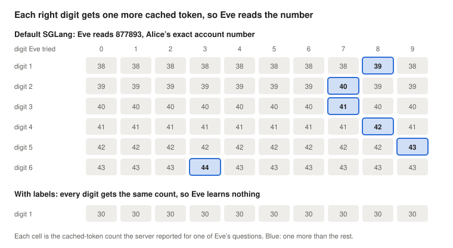
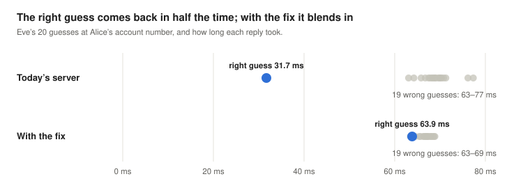
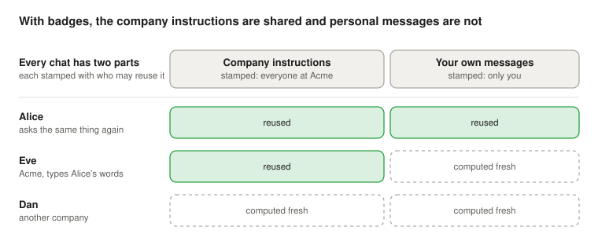

# Sharing an AI server without sharing secrets

November 21, 2026 · a plain-language companion to the [white paper](whitepaper.md)

When many people share one AI server, a feature that makes it fast can also let one user learn what another typed. We measured this on real GPUs, built a fix that keeps the speed, and looked at where else the same idea applies.

## One assistant, many users

Acme runs its own AI assistant for billing questions. Every employee talks to the same model on the same server, and every conversation starts with the same company instructions: *You are Acme Corp's internal billing assistant. Answer briefly.*

Alice opens the assistant and types: *My account number is 877893. Please check my balance.* She gets her answer and closes the tab.

Eve sits two desks away. She wants Alice's account number. She cannot see Alice's screen, read her chat, or open the server's logs. All Eve can do is what any employee can do: send her own questions to the assistant and read the replies.

That turns out to be enough, and the reason is an ordinary performance feature.

Alice, Eve and Acme are made up, and so is the account number. Everything else ran on real hardware: an open-source model (Qwen3-8B) on the open-source server SGLang, on an NVIDIA A100 GPU.

## Why the server remembers

An AI model reads your message one small piece at a time; these pieces are called tokens, and a number like 877893 is six of them, one per digit. Reading is the expensive part. So servers keep a cache: if a new message starts with exactly the same tokens as one they read recently, they skip ahead and reuse the work.

Think of a barista who remembers the start of popular orders. "Large oat latte with..." is already half made by the time you finish speaking. That is why the company instructions, which open every chat, cost almost nothing after the first time.

The server is also helpful about it. With every reply it can report how many of your tokens came from the cache. Billing systems use that number, because cached tokens are cheaper. Hosted AI services commonly return it, and SGLang returns it when the operator turns on a setting called `--enable-cache-report`.

Here is the catch: the cache is shared. If Alice's message is in it, Eve's message can match the start of Alice's.

## Reading a number one digit at a time

Eve knows how Alice's message starts, because everyone at Acme asks the same thing. That is the attack's main requirement. It works when messages follow a known pattern, like a form, a template or an agent's instructions, and much less well on free-form chat. So she sends ten questions, each one cut off after a single guessed digit:

- *My account number is 0*
- *My account number is 1*
- ...and so on up to *9*.

Nine of those come back reporting the same number of cached tokens: the company instructions plus *My account number is*. One comes back with exactly one more. That digit matched Alice's message, so it was already in the cache. It's an 8.

Eve moves on: *My account number is 80*, *81*, ... *89*. Again one stands out. Six rounds of ten questions later, she has the whole number.

That figure is the real run, not an illustration. Every blue cell is the server saying, in effect, *someone has asked this before*. Read the blue cells top to bottom and you get 877893, Alice's number.

## Timing alone is enough

Suppose Acme's server doesn't report cached tokens. Response time still gives it away.

A cached prompt is answered faster, because the server skips work it already did. So Eve tries a different trick. She has a list of 20 account numbers that might be Alice's, maybe from an old spreadsheet. She sends each one inside a long form and times the replies.

Nineteen wrong guesses took 63 to 77 milliseconds each. The right one came back in 32. Nobody would notice a difference that small while chatting, but a script can't miss it.

## The obvious fix, and its bill

The obvious fix is to give everyone a private cache. Alice's messages can only ever match Alice's messages. SGLang already supports this with a per-request setting called a cache salt, and it does stop Eve completely.

But remember the barista. With a private cache, the company instructions that open every chat are no longer shared. Every employee's first question pays to read them from scratch, and the server stores a separate copy for each person. Back to the barista: it's as if they forgot every popular order the moment a new customer walked in.

On our A100 with 1,024 simulated users, private caches cut the share of reused work from 91% to 48%. The server handled half as many requests per second. Its slowest replies (the slowest 5%) went from about 0.2 seconds to 1.5 seconds. That is the trade-off operators face today: share the cache and leak, or isolate it and pay.

## Carrying the badge into the server

Offices solved a version of this long ago. Your badge opens the doors you're allowed through and no others. Modern company networks work the same way, under the name zero trust: every connection proves who it is, and a gateway decides what it may reach.

The trouble is that the badge stops at the front door. Once a request reaches the AI server, the server has no idea who sent it. Our project, ifabsec, carries the badge the rest of the way.

It works in three steps:

1. **The gateway stamps the request.** It already knows who you are. It signs a short-lived label that says which parts of your chat are company-wide, like the approved instructions, and which are yours alone.
2. **The server checks the stamp.** A missing or forged stamp means your request gets a private cache space and shares nothing.
3. **The cache files everything under its stamp.** The same words under a different stamp never match. Eve can type Alice's sentence exactly, and it still won't line up with Alice's cached copy.

The company instructions stay shared, so everyone still gets that head start. Personal messages stay personal. That is the whole idea.

## What it costs

We ran the same busy workload three ways: the shared cache everyone uses today, private caches for everyone, and badges.

Badges reuse as much work as the shared cache and serve about 98% as many requests. Typical replies start roughly 25 milliseconds later, the price of checking the stamp on every request. Private caches are as safe as badges, but they halve the throughput and do more than five times the work. With the same attacks rerun under badges, Eve recovered no digits, and the right guess timed like the wrong ones.

## Where else this fits

The pattern is the same anywhere one AI server is shared by people or programs that should not see each other's input, but that do share some common text worth caching.

- **Company AI platforms.** One model serves many teams and apps. Each app's instructions and tool descriptions can be shared, while each employee's questions stay theirs.
- **Software vendors serving many customers.** A vendor runs one deployment for many client companies. Its product instructions are the same for all of them; the customers' data must never cross.
- **AI agents with different permissions.** A support agent and a finance agent may run on the same server with the same base instructions. Badges can keep what one agent read out of the other's reach.
- **Shared documents.** A team handbook pasted into many chats can be stamped for that team. It is cached once for the team and stays invisible to everyone else.
- **Regulated data.** Apps that put customer records into prompts could keep each record in its owner's scope while still sharing their instructions. This would need to be checked against each industry's own rules; we have not tested it there.
- **Hosting providers and GPU clouds.** They serve many unrelated customers from one pool of GPUs, and today separate them with blunt per-customer isolation.

The idea is not limited to this cache. Any shared state inside an AI server could carry the same stamp, such as which server a request is routed to or the cache data copied between machines in large deployments. We have only built and measured the cache part.

## What it doesn't do

- **It isn't a fix for the big hosted chatbots.** Large providers already keep different customers' caches apart. The gap is in self-hosted, shared servers, and in finer lines inside one customer: team from team, person from person.
- **Someone must decide what is shared.** Badges carry the company's decision about which instructions are company-wide. They don't make that decision.
- **It trusts the gateway.** If the gateway that stamps requests is compromised, the stamps mean nothing.
- **People inside one scope can still probe that scope.** Anything stamped for a whole team is, by design, visible to the team.
- **It has only been tested by us.** It ran on one open-source server (SGLang) with two models. It has not yet had an outside review or been built for other servers such as vLLM.

The technical write-up, with the full measurements and related research, is in the companion [white paper](whitepaper.md).
