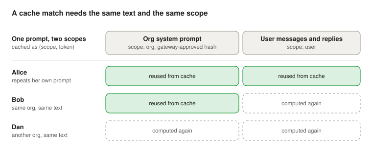
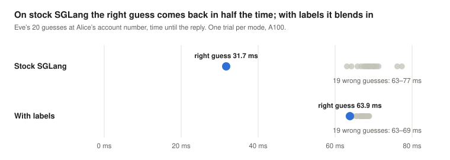

# ifabsec: zero trust inside the inference engine

November 22, 2026 · [code and data](https://github.com/nvsrinivas/ifabsec)

Shared LLM inference servers leak what one tenant sent to another through their prefix cache. Per-tenant isolation fixes the leak only by discarding the cache hits that make sharing worthwhile. ifabsec carries verified identity from a zero-trust network layer into the inference engine and enforces it in the cache keys. The goal is per-user isolation without giving up the shared cache. On an A100 running Qwen3-8B on SGLang, a same-org co-worker recovered a 6-digit account number from stock SGLang in every extraction trial, and nothing with ifabsec. With 1,024 users and 16 requests in flight, ifabsec kept stock's cache hit rate (90.4% vs 90.6%) and about 98% of its throughput, twice that of per-user isolation. Median time to first token rose by 25 ms in that run, and by 90 ms in an earlier, more concurrent run made before two overhead fixes. A port to vLLM, on the same A100, took guessing a user's account from 20 candidates from 100% on stock to chance and kept 92–94% of stock's throughput, against 43–63% for per-user isolation. A simpler alternative, a per-user tag written into the prompt, costs less but changes what the model reads and, in the check, what it answered.

## Background: prefix caching

Prefix caching reuses the attention state of a prompt's opening tokens across requests, cutting time to first token while computing the same result. Its defining property, that any request can reuse any matching prefix, is also what makes it observable across tenants.

SGLang is an open-source inference engine. It loads a model onto GPUs, serves an OpenAI-compatible API, batches requests from many users continuously, and manages the KV cache in GPU memory. vLLM and TensorRT-LLM fill the same role. ifabsec patches SGLang and vLLM, the two most widely used open-source engines; the idea applies to any engine with a shared prefix cache.

- **Two phases.** LLMs generate autoregressively, each token predicted from all tokens before it. Prefill computes the attention keys and values for every prompt token at every layer; this is the KV cache. Decode then generates one token at a time while attending to that cache. For long prompts, prefill dominates time to first token.
- **Reuse across requests.** A KV cache normally lives only for its request. Prefix caching keeps the entries afterwards and reuses them for any later request whose token sequence starts the same way.
- **Exact, but prefix-only.** Attention is causal, so a token's keys and values depend only on the tokens before it. Reuse is therefore mathematically exact, though floating-point differences can change a long greedy output slightly, as any change in batching can. And it applies only to an identical prefix. The same text after a different opening cannot reuse anything.
- **Implementations.** SGLang keeps entries in a radix tree keyed by token ids (RadixAttention). vLLM hashes fixed-size blocks, each hash chained over the prefix before it. Hosted APIs offer the same idea as prompt caching, usually priced below uncached input.
- **What gets shared.** System prompts, tool schemas, few-shot examples, retrieved documents, and the earlier turns of a conversation. Entries live in GPU memory and are evicted, least recently used first, under pressure.

## The problem

A prefix cache reuses the computed state of any prompt that starts with text already seen, so a cached prompt answers faster and many servers report how many of its tokens were cached. If the cache is shared across tenants, anyone can test whether someone else just sent a given text: guess, send, and watch the speed or the cached-token count. A Stanford audit detected cache sharing across users in production APIs from seven providers, including OpenAI.

The usual fixes trade one problem for another:

| Policy | Who can learn what others sent | Cost |
| --- | --- | --- |
| One shared cache (stock) | Any tenant | None |
| A cache per org | Other users in the same org | Small |
| A cache per user, e.g. a gateway-set `cache_salt` | No one | Every user re-computes and stores the org's shared system prompt and tool schemas |

The gap is a policy that is as safe as per-user isolation but keeps the sharing an org actually wants.

## The approach

The gateway decides and the engine enforces, the same split as in zero-trust network access, carried past the front door into the GPU server.


The gateway signs what each part of a prompt may share. Inside the engine, the HTTP process checks the label once, and the cache keys carry its scope from there on.

1. **Identity.** A user or agent is authenticated by the zero-trust layer. In this prototype the gateway is a token library and command-line tool; the service that turns that identity into tokens is future work.
2. **Label token.** A policy gateway mints a short-lived Ed25519-signed token per request: which scopes the request may read (`public`, `org`, `team`, `user`) and which messages belong to which scope. A shared segment must match a content hash the gateway approved, such as the org's registered system prompt.
3. **Scoped cache keys.** Inside SGLang, every cached token is keyed by `(scope, token)` instead of `token`. Identical text under different scopes never matches, so a probe cannot form the victim's key. The radix tree itself is unchanged. vLLM caches whole blocks (16 tokens in these runs) under chained hashes; there each block's hash carries the scope of its last token, so the block that straddles a boundary is cached as the narrower scope.
4. **Narrowing.** A token's cached state depends on everything before it, so a scope can only narrow along the prompt: the org's system prompt is shared across the org, and everything after the approved segment is the user's alone.
5. **Fail closed.** On the chat endpoint, a request with a missing or invalid label, a client-chosen cache salt, or image input is rejected. Other endpoints, and any request whose internal salt does not verify, get a cache space of their own and share nothing.



After Alice's request is cached, identical text is not enough to reuse it: Bob in her org reuses only the approved org prompt, and a user in another org reuses nothing.

The change to SGLang itself is small: 32 added lines across 5 files and a 100-line hook module, active when IFAB_MODE is observe or enforce. The vLLM patch changes about 20 lines in two files, plus its own hook module. Both hooks call the same ifabsec engine package, about 1,200 lines of Python.

## Threat model and limits

Labels defend against a tenant with ordinary API access who watches response times and cached-token counts. They trust the gateway that signs labels, and they leave probing within a scope open by design.

- **Stopped:** probing across scopes through cache hits, cached-token counts or first-token timing; clients choosing their own cache salt; unlabeled chat requests, which are rejected. Other unlabeled traffic gets a private cache space. Client documents, template options and extra message fields never join a shared segment: boundaries come from rendering only each message's role and text with the server's own template, so whatever else a template places there moves the boundary earlier.
- **Trusted:** the gateway, which authenticates users and decides what is shared, and the engine host. A compromised gateway can label anything as shared. Each gateway key can be limited to the orgs it may mint for, so one leaked key exposes only those orgs.
- **Allowed by design:** anyone inside a scope can still probe that scope. Team-scoped text is visible to the whole team.
- **Policy, not mechanism:** someone must decide which prompts are org-approved. The token carries that decision; it does not make it.
- **Replay:** each engine process remembers token IDs until they expire: at most 5 minutes, plus 30 seconds of allowed clock skew. Tokens are bearer credentials, so a captured unused token works until then, and separate processes or replicas each accept it once. The gateway-to-engine hop therefore needs its own protection, such as mTLS or the zero-trust layer itself, which this prototype does not provide yet.
- **Not covered:** eviction-pressure probing (per-scope quotas planned); timing from batching and queueing; KV transfer between nodes in disaggregated serving; SGLang's other cache backends, which fail closed and lose sharing; on vLLM, multimodal input and the Responses and Anthropic endpoints (isolated) and external KV connectors such as LMCache. Tool schemas passed in the API's tools field are shared only when the token approves them by hash; unapproved schemas stay in the user's scope. The engine also tokenizes the prompt and checks the signature before it can reject a bad label, which gives an attacker some cheap load. With several vLLM API servers (`--api-server-count`), each process keeps its own replay set, so a captured token can be replayed once per process. vLLM's optional KV-event stream carries raw token ids (with keyed, not readable, scope ids), so its consumers must be trusted like the engine.
- **Not yet reviewed:** nobody outside this project has reviewed the token design.

## Evaluation

Stock SGLang leaked a full account number to a same-org co-worker on both GPUs, and labels closed every channel tested while keeping the org prompt shared. Setup: SGLang `efab9d61` with the ifabsec patch (vLLM in its own section below), Qwen3-8B unless noted, synthetic tenants, attacks only against servers set up for the tests. Eve sits in Alice's org, so she legitimately shares the org system prompt.

### How the attack works

Eve needs nothing but the API and the cached-token count that comes back in each response's usage block. SGLang's chat endpoint reports that count only when the server runs with `--enable-cache-report`, which the tests turn on; many hosted APIs report it by default, and the timing channel needs no count at all. The prompts below are the ones the test harness sends; the account number is drawn at random for each trial, and this one is from the A100 run below.

```text
System (shared by the org):  You are Acme Corp's internal billing assistant. Answer briefly.
Alice sends:                 My account number is 877893. Please check my balance.

Eve probes, one request each, and reads cached_tokens from the response:
  My account number is 0   ->  cached count stays at the shared prefix
  My account number is 8   ->  cached count is one token higher: the first digit is 8
  My account number is 80 ... 89   ->  one more token for 87
  ...six positions, ten probes each, and the full number is recovered
```

The extraction works because the tokenizer splits digits, so every correct digit extends Alice's cached prefix by exactly one token. With labels, Alice's message is cached under her own scope, so none of Eve's probes match past the shared system prompt and every digit looks the same.


The guessing attack is the coarser version: Eve holds a list of 20 candidate account numbers, sends each one inside a long form, and picks the probe that returned fastest or with the most cached tokens.



On stock SGLang the right guess also returned 579 cached tokens against 37–39 for the others; with labels it returned 37, within the 35–39 of the others.

### Attacks


On stock SGLang (4090 figures from the first of two runs), a right guess came back 42 ms faster on the 4090 and 36.6 ms on the A100; with labels the gap was under 0.3 ms, which is noise. The 4090 caps stock guessing at 70% because its 6,860-token KV cache evicts Alice's entry partway through a trial; the A100 has no such limit. On Phi-4-mini, stock guessing also reached 100% with a 14.4 ms gap, and labels brought it to 10% and 0%.

### Correctness

- The labeled path feeds the model exactly the same token ids as stock and, with caches flushed, produces the same greedy output.
- Alice's repeat of her own prompt hits all but the last token; Bob, in her org, gets exactly the org prompt; a user in another org gets nothing.
- A second chat-template family, Phi-4-mini, first failed closed: its template appends an end-of-text token when rendering a partial chat. Defining the boundary as the common prefix with the full prompt fixed it, and all checks pass with no isolated requests. Tool schemas approved by the token were shared on the A100 (155 tokens with the org prompt, against 18 without), unapproved ones were not, and altered ones were rejected.

### Cost under load

Labels keep stock's hit rate and about 98% of its throughput, while per-user isolation halves throughput and computes 5.4× more prompt tokens than labels. Workload on the A100: 4 orgs × 256 users, two-turn sessions, 16 in flight, averaged over runs.


At the median, labels' first token took 191 ms against stock's 166 ms and per-user isolation's 213 ms; across three runs it ranged from 183 to 200 ms. An observe mode that runs every check but keys the cache like stock sat at 175 ms, so the checks themselves account for about 9 ms. Profiling finds only a few milliseconds per request: about 0.5 ms in the scheduler and 2.2 ms in the HTTP process, 0.7 ms of it CPU. The rest of the gap is within run-to-run variation and has not been located. In an earlier run at 256 users with more requests in flight, made before two overhead fixes, the median gap was 90 ms (362 vs 272 ms).

In a simulation of 20 orgs with 50 users each, an agent workload with a 6,000-token system prompt kept a 94.8% hit rate with labels, the same as stock, versus 74.9% with per-user isolation. That workload is favourable: when users paste shared documents the gateway has not approved, labels recover about half of the lost hits.

### vLLM

The port to vLLM v0.34.0 ran on the same A100 with Qwen3-8B and 16-token cache blocks, set explicitly: the smallest this GPU's attention kernel accepts, so the most an attacker can learn per probe ([results](results/2026-11-22-a100-vllm.md)). All 15 checks pass: identical model input and greedy output; Alice's resend hits 48 of 53 tokens, Bob in her org 16 (the one full block of the 18-token org prompt), and a user in another org 0; tool schemas behave as on SGLang.

| | stock vLLM | labels | chance |
| --- | --- | --- | --- |
| Guess from 20 candidates, cached-token channel | 1.0 | 0.0 | 0.05 |
| Guess from 20 candidates, timing channel | 1.0 | 0.1 | 0.05 |
| Right-vs-wrong timing gap | 31.0 ms | 0.5 ms | |
| Digits extracted (of 6) | 0 | 0 | |

Extraction failed on stock vLLM too. vLLM counts cached tokens in whole blocks, so one guessed digit moves the count only when it completes a block. An attacker who guesses up to three digits at once (1,110 probes per trial) still found no block boundary in five trials. Block granularity raises the price of reading out a short secret tenfold per digit guessed together; it does not stop confirming a guess from a list, which worked every time.

Under load (4 orgs, 16 to 256 users in total, two-turn sessions, 32 in flight), labels kept stock's hit rate within 0.6 points and 92–94% of its throughput; per-user salting kept 43–63%. That is more than SGLang's 2%, and observe mode shows where it goes: running every check while keying the cache like stock already costs 4–8%, and scoped keys add 0–3%. The checks take about 2.7 ms per request (1.5 ms finding segment boundaries, 0.6 ms verifying the token) on the event loop that every request passes through in a vLLM API server process; a block-key call takes 14 µs. Each configuration ran two rounds and observe ran on a separate server start, so the split between checks and keys is within run-to-run variation; the total cost is the firmer number.

### A simpler alternative: a user tag

A gateway can keep most of the sharing with no engine change by writing an opaque per-user tag right after the system prompt, so that prompts diverge at the tag. On vLLM this kept 96–99% of stock throughput, with hit rates matching labels. It has two costs labels avoid. The model reads the tag: in the check, the prompt grew from 36 to 45 tokens and the 48-token greedy output changed, where labels left both identical. And the engine trusts whatever text arrives, so anything that reaches it past the gateway can write any tag. A tag suits one trusted gateway in front of one team; it does not give the engine verified isolation.

## Deployment

ifabsec is a small patch plus a token library, off by default and switched on per server.

- **vLLM patch:** about 20 changed lines in two files (block-hash extra keys, frontend hashes and the chat endpoint) and a hook module, for v0.34.0. The same three modes apply.
- **SGLang patch:** 32 added lines across 5 files, a 100-line hook module, and the ifabsec engine package (about 1,200 lines of Python) that the hook calls. With `IFAB_MODE=off` the engine behaves exactly like stock; `observe` runs every check but keys the cache like stock and logs failures instead of rejecting, for measuring; `enforce` turns isolation on.
- **Inside the engine:** the HTTP process verifies the label once. It hands the scheduler an internal salt, authenticated with a server key and bound to the request's exact input tokens, so the scheduler never parses tokens and a request cannot borrow another's scopes.
- **Gateway side:** a Go library and command-line tool mint and verify label tokens; Python verifies the same test vectors. The gateway service that turns zero-trust identity into tokens is not built yet.
- **Configuration:** the server's audience name, the gateway's public keys, each optionally limited to the orgs it may mint for, and an internal key shared by the engine's processes.
- **Other engines:** not ported. Any engine that keys its prefix cache by token sequence can take the same scope keys.

## Related work

Other defenses decide inside the engine what is sensitive; ifabsec takes that decision from an authenticated policy at the network edge. The closest idea, boundary salting, has the same shape as ifabsec's scopes, and ifabsec supplies the authenticated identity and boundary it assumes.

| Work | Approach | How ifabsec differs |
| --- | --- | --- |
| [Gu et al., ICML 2025](https://arxiv.org/abs/2502.07776) | Audit: detected global cache sharing in production APIs from seven providers | The attack setting ifabsec defends against |
| [KVGov](https://arxiv.org/abs/2608.09225) | Boundary salting: blocks before a divergence point stay shared, a per-principal salt applies after it; vLLM's root `cache_salt` is all-or-nothing | Same structure; ifabsec gets the principal and boundaries from a signed token and enforces them in a running engine |
| [SafeKV](https://arxiv.org/abs/2508.08438) | Detects sensitive content in the runtime and isolates those KV blocks; up to 2.66× throughput over isolation baselines | Sharing set by policy, not by detecting sensitive content |
| [CacheSolidarity](https://arxiv.org/abs/2603.10726) | Tracks reuse across users, flags suspicious sharing, isolates flagged prefixes | Prevents cross-scope matches up front rather than reacting to suspicious reuse |
| [CachePrune](https://arxiv.org/abs/2605.23640) | Fine-grained sharing of privacy-irrelevant segments such as system instructions | Same goal; segments marked by a signed gateway policy |

ifabsec appears to be the first to enforce gateway-signed sharing scopes inside production engines' prefix caches, measured for both leakage and cost on real GPUs. That claim needs a fuller literature check before publication.

## Next steps

The priority is an outside review of the token design. After that: lower ingress cost, then more nodes.

1. Outside review of the token format, scope rules and fail-closed paths.
2. Lower ingress cost, which matters most on vLLM: cache boundary renders per approved prompt and move verification off the API server's event loop.
3. Multiple replicas: label-aware routing, and shared replay state or a policy that relies on short expiry.
4. Disaggregated serving: scopes carried with KV transfers between prefill and decode nodes.
5. A gateway service that turns zero-trust identity into label tokens end to end.
6. Per-scope eviction quotas against eviction-pressure probing.
7. Proposals to SGLang and vLLM upstream for gateway-set cache scopes.

## Author and AI use

Srinivas N. Veereshwara. Carrying zero trust from the network edge into AI inference.

This paper was written with AI assistance (Claude), and the prototype was built and run by the author with AI assistance. All measurements come from runs on rented NVIDIA A100 and RTX 4090 GPUs; the raw results and the code to reproduce them are in the [repository](https://github.com/nvsrinivas/ifabsec).

## Sources

- Gu et al., [Auditing Prompt Caching in Language Model APIs](https://proceedings.mlr.press/v267/gu25b.html), ICML 2025.
- [Governing the KV Cache: Preventing Timing Side-Channel Leakage in Multi-Tenant LLM Inference](https://arxiv.org/abs/2608.09225) (KVGov), arXiv 2608.09225.
- Chu et al., [Selective KV-Cache Sharing to Mitigate Timing Side-Channels in LLM Inference](https://arxiv.org/abs/2508.08438) (SafeKV), arXiv 2508.08438.
- Pennas et al., [CacheSolidarity: Preventing Prefix Caching Side Channels in Multi-tenant LLM Serving Systems](https://arxiv.org/abs/2603.10726), arXiv 2603.10726.
- Wu et al., [CachePrune: Privacy-Aware and Fine-Grained KV Cache Sharing for Efficient LLM Inference](https://arxiv.org/abs/2605.23640), arXiv 2605.23640.
- Full setup and raw numbers: [`results/2026-11-21-rtx4090.md`](results/2026-11-21-rtx4090.md), [`results/2026-11-21-a100.md`](results/2026-11-21-a100.md), [`results/2026-11-22-a100-vllm.md`](results/2026-11-22-a100-vllm.md) and [`../sim/README.md`](../sim/README.md).
